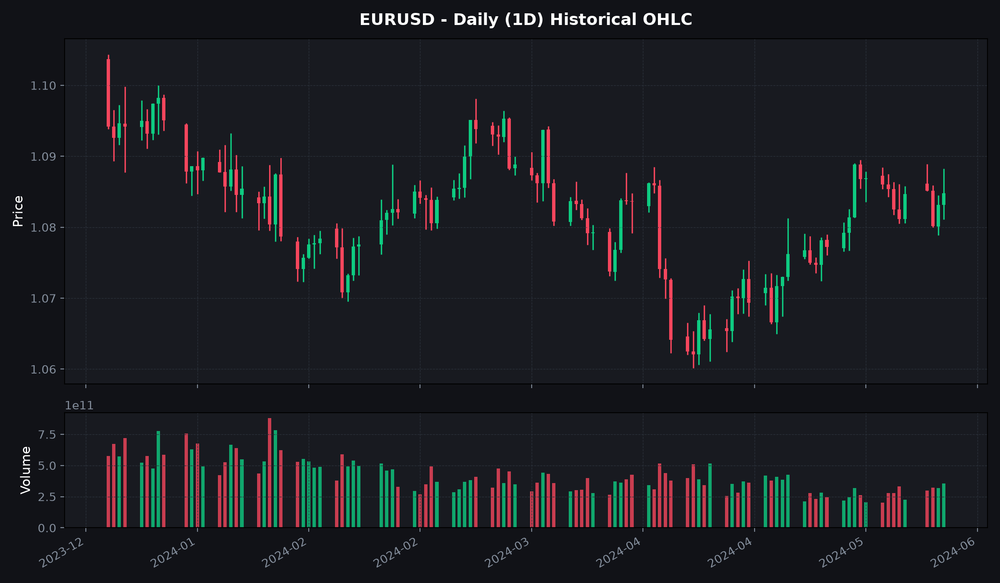
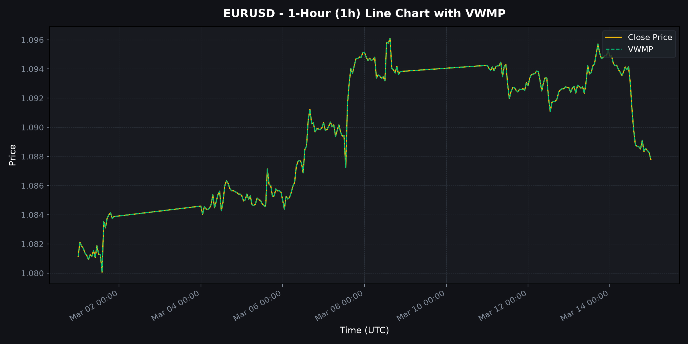

# <span style="font-size:1.5em;">FOREX DATA</span>

[](https://nikfio.github.io/forex_data/)
[](https://circleci.com/gh/nikfio/forex_data)
[](https://pypi.org/project/forex-data-aggregator/)
[](https://www.python.org/)
[](https://astral.sh/uv)

> 📚 **[View Full Documentation](https://nikfio.github.io/forex_data/)** | 🚀 **[Quick Start](#installation)** | 💡 **[Examples](#examples)**

The forex_data package offers ways to aggregate data from the Forex market into a dataframe having the the essential OHLC information, so the ouput will always have the columns:

* timestamp
* open
* high
* low
* close

The purpose is to aggregate data in OHLC format from multiple sources, optimize data caching and provide an interface to easily access and use the data: the main outcome from the interface is a dataframe.

At the moment, sources are divided in **historical sources** and **real-time sources**.

## SOURCES

### HISTORICAL SOURCE

A historical source provides data tipically from the first years of 2000s and the free tier is fine for the purposes of the package. The update rate is slow but data can be retrived with a low resolution like 1-minute timeframe.

The historical source used in the package is [histdata.com](http://www.histdata.com/), which work is really genuine and a lot appreciated.

Summarizing, a historical source can provide tons of data even from many years ago and with no limits at the downside of a slow update rate. For example, *histdata* updates data on a montly basis.

### REAL-TIME SOURCE

A real-time source is what is more tipically known as a source for forex market or stock market data. It offers APIs in determined clients or even just a minimal documentation to establish the API call in HTTP request format.
A minimal free or trial offering is proposed, but they rely on premium subscriptions offers based on:

* real time performance 
* size of tickers list available
* how much history of a ticker 
* and many other parameters ...

As of now, [Twelve Data](https://twelvedata.com/) is integrated for real-time market data access. The intention is to make the most out of their free tier access to data.

## INSTALLATION

### From PyPI (Recommended)

The easiest way to install forex_data is via uv or pip:

```bash
uv pip install forex-data-aggregator
# or
pip install forex-data-aggregator
```

### From Source

If you want to install from source or contribute to development:

1. Ensure you have [uv](https://docs.astral.sh/uv/) installed
2. Clone the repository:
```bash
git clone https://github.com/nikfio/forex_data.git -b master forex-data
cd forex-data
```
3. Install dependencies:
```bash
uv sync
```
4. Run tests to verify installation:
```bash
uv run pytest
```

## DOCUMENTATION

📖 **Comprehensive documentation is available at [nikfio.github.io/forex_data](https://nikfio.github.io/forex_data/)**

The full documentation includes:

- **[Installation Guide](https://nikfio.github.io/forex_data/installation.html)** - Detailed setup instructions
- **[Quick Start Tutorial](https://nikfio.github.io/forex_data/quickstart.html)** - Get started in minutes
- **[Configuration Reference](https://nikfio.github.io/forex_data/configuration.html)** - All configuration options explained
- **[API Reference](https://nikfio.github.io/forex_data/forex_data.html)** - Complete API documentation with type hints
- **[Code Examples](https://nikfio.github.io/forex_data/examples.html)** - 15+ comprehensive examples
- **[Contributing Guide](https://nikfio.github.io/forex_data/contributing.html)** - How to contribute to the project
- **[Changelog](https://nikfio.github.io/forex_data/changelog.html)** - Version history and updates

## CONFIGURATION FILE

A configuration file can be passed in order to group fixed parameters values.
In repository folder clone, look for [appconfig folder](appconfig) to see the [example template file](appconfig/appconfig_template.yaml).

In data managers instantiation, you can pass directly the absolute path to the YAML file or also a folder.
In the second case, it will look for the configuration file ending with `data_config.yaml` in the specified folder.
Furthermore, any parameter value can be overridden by explicit assignment in object instantion.
The feature will be more clear following the [examples section](#examples).

#### Default Engine & Storage Format

`forex-data` standardizes on high-performance columnar processing and storage:
* **Engine**: `polars_lazy` (default and only maintained processing engine). Query graphs and aggregations run via lazy evaluation for optimal predicate pushdown and execution speed.
* **Storage Type**: `parquet` (default and only maintained cache file format). Snappy-compressed columnar Parquet files provide minimal disk usage and blazing fast parallel reads.

Because these are built-in defaults, you **do not need** to specify `ENGINE` or `DATA_TYPE` in configuration files.

#### Configuration Parameters

* **`DATA_PATH`**: Absolute or relative directory path where downloaded market data files and local databases will be stored. Defaults to `~/.database/` (or `~/.test_database` for test suites).
* **`DEVICE`** *(Optional)*: Compute device selection (`auto`, `cpu`, `cuda`). Default is `auto`.
* **`POLARS_GPU_ENGINE`** *(Optional)*: Boolean flag to enable Polars GPU engine acceleration (`True` or `False`). Default is `False`.

#### Minimal Configuration Template (`data_config.yaml`)

```yaml
---
# yaml document for data management configuration

DATA_PATH: '~/.test_database'

# Optional GPU acceleration
DEVICE: 'auto'
POLARS_GPU_ENGINE: False
```

## LOGGING

Logging feature is added via loguru library.
By construction log is dumped in a file which location is determined by pathlib.
A generic usage folder for the package named `.database` is created at the current user home folder.
Here log is dumped in a file called `forexdata.log`, the complete location of the log file will be:

`~/.database/forexdata.log`

## CLI

The `forex-data-aggregator` package includes a command-line interface script at `cli/fx_agg_app.py` to manage data generation and charting from the terminal.

### `generate-database`

Generate and cache historical forex data in the local database. It downloads missing historical periods and caches them automatically.

**Arguments:**
* `tickers`: Ticker symbol or a list of symbols separated by comma (e.g., EURUSD, GBPUSD).
* `start_date`: Start date for data retrieval (format: YYYY-MM-DD or YYYY-MM-DD HH:MM:SS).
* `end_date`: End date for data retrieval (default: `now`).

**Options:**
* `--timeframe`, `-t`: Timeframe interval(s) (e.g., 1m, 5m, 1h, 1D; minimum resolution: 1m). Can be specified multiple times or as comma-separated. Default is `1D`.
* `--data-path`, `-d`: Database root directory path. Defaults to `DATA_PATH` configured in `appconfig/data_config.yaml` (e.g. `~/.test_database`).
* `--offline`, `--no-download`: Run in offline mode without attempting remote downloads.
* `--config`, `-c`: YAML configuration file path or a YAML formatted string.

**Example:**
```bash
uv run python cli/fx_agg_app.py generate-database EURUSD,GBPUSD 2018-01-01 2018-12-31 -t 1D,1h
```

### `plot`

Launch an interactive plot for historical or live forex data.

**Arguments:**
* `ticker`: Ticker symbol (e.g., EURUSD).
* `start_date`: Start date (format: YYYY-MM-DD or YYYY-MM-DD HH:MM:SS).
* `end_date`: End date (format: YYYY-MM-DD). Use `now` for a static plot up to the current time, or `live` to launch a continuous real-time Dash server.
* `timeframe`: Timeframe interval (e.g., 1m, 5m, 1h, 1D; minimum resolution: 1m).

**Options:**
* `--type`: Type of chart to display (`ohlc`, `line`, `scatter`). Default is `ohlc`.
* `--data-path`, `-d`: Database root directory path. Defaults to `DATA_PATH` configured in `appconfig/data_config.yaml` (e.g. `~/.test_database`).
* `--offline`, `--no-download`: Run in offline mode without attempting remote downloads.
* `--config`, `-c`: YAML configuration file path.
* `--port`: Port for the Dash realtime server (when `end_date=live`). Default is `8050`.
* `--interval`: Realtime refresh interval in milliseconds. Default is `1000`.

**Examples:**
```bash
# Static historical plot up to the current time (offline from existing DB)
uv run python cli/fx_agg_app.py plot EURUSD 2024-01-01 now 1D --no-download

# Custom data path
uv run python cli/fx_agg_app.py plot EURUSD 2024-01-01 2026-06-06 1D -d ~/.test_database

# Live interactive plot starting from a specific date, updating continuously
uv run python cli/fx_agg_app.py plot EURUSD 2024-01-01 live 1D --port 8050
```

## EXAMPLES

You can find complete working examples in the [examples folder](examples/) showing the various modules and functionalities the package offers.

To run the examples:

```bash
# Historical data example
uv run python examples/histdata_db_manager.py

# Real-time data example (requires Twelve Data API key as environment variable)
export TWELVE_DATA_API_KEY="your_key_here"
uv run python examples/realtime/realtime_twelvedata_connector.py
```

#### Historical data 

Let's walk through the [example for historical data source](examples/histdata_db_manager.py):

1. **Configuration setup**
    ```python
    # Use a runtime defined config yaml file (defaults to parquet and polars_lazy)
    test_config_yaml = '''
    DATA_PATH: 'ABSOLUTE-PATH-TO-DATA-DIRECTORY'
    '''
    ```
    You can define configuration inline or use a file. The configuration can override specific settings.
<br>

2. **Data manager instance** 
    ```python
    from forex_data import HistoricalManagerDB
    
    histmanager = HistoricalManagerDB(
        config=test_config_yaml
    )
    ```
    Create an instance of the historical data manager with your configuration.
<br>

3. **Get data**
    ```python
    ex_ticker = 'EURUSD'
    ex_timeframe = '1d'
    ex_start_date = '2018-10-03 10:00:00'
    ex_end_date = '2018-12-03 10:00:00'
    
    yeardata = histmanager.get_data(
        ticker=ex_ticker,
        timeframe=ex_timeframe,
        start=ex_start_date,
        end=ex_end_date
    )
    ```
    The call returns a dataframe with data having the timeframe, start, and end specified by the inputs.
    The output dataframe type depends on the engine selected (polars_lazy, polars, pandas, pyarrow).

    With `polars_lazy` as ENGINE option, the output dataframe:
    ```
    ┌─────────────────────┬─────────┬─────────┬─────────┬─────────┐
    │ timestamp           ┆ open    ┆ high    ┆ low     ┆ close   │
    │ ---                 ┆ ---     ┆ ---     ┆ ---     ┆ ---     │
    │ datetime[ms]        ┆ f32     ┆ f32     ┆ f32     ┆ f32     │
    ╞═════════════════════╪═════════╪═════════╪═════════╪═════════╡
    │ 2018-10-03 21:00:00 ┆ 1.1523  ┆ 1.1528  ┆ 1.1512  ┆ 1.1516  │
    │ 2018-10-04 21:00:00 ┆ 1.1516  ┆ 1.1539  ┆ 1.1485  ┆ 1.1498  │
    │ 2018-10-05 21:00:00 ┆ 1.1498  ┆ 1.1534  ┆ 1.1486  ┆ 1.1514  │
    │ ...                 ┆ ...     ┆ ...     ┆ ...     ┆ ...     │
    └─────────────────────┴─────────┴─────────┴─────────┴─────────┘
    ```
<br>

4. **Add a timeframe**
    ```python
    histmanager.add_timeframe('1W')
    ```
    Add a new timeframe. The data manager will create and cache the new timeframe data if not already present.
<br>

5. **Plot data**
    Using `DataCharts` (which extends `HistoricalManagerDB` with interactive Plotly and Dash visualization capabilities):
    ```python
    from forex_data import DataCharts

    charts = DataCharts(data_path="~/.test_database", offline=True)
    charts.plot_historical(
        ticker="EURUSD",
        timeframe="1D",
        start_date="2024-01-01",
        end_date="2024-06-01"
    )
    ```
    This renders an interactive candlestick chart complete with volume histograms and toolbar controls:

<br>



<br>

6. **Conditional Data Retrieval**

    You can filter data directly during retrieval using SQL-like conditions.

    ```python
    from forex_data import (
        HistoricalManagerDB, 
        COLUMN_NAME, 
        SQL_COMPARISON_OPERATORS
    )

    # 1. Simple condition: OPEN < 1.13
    data = histmanager.get_data(
        ticker='EURUSD',
        timeframe='1D',
        start='2018-01-01',
        end='2018-12-31',
        comparison_column_name=COLUMN_NAME.OPEN,
        check_level=1.13,
        comparison_operator=SQL_COMPARISON_OPERATORS.LESS_THAN
    )

    # 2. Multiple conditions (OR): HIGH > 1.145 OR LOW < 1.12
    from forex_data import SQL_CONDITION_AGGREGATION_MODES

    data = histmanager.get_data(
        ticker='EURUSD',
        timeframe='1D',
        start='2019-01-01',
        end='2019-12-31',
        comparison_column_name=[
            COLUMN_NAME.HIGH, 
            COLUMN_NAME.LOW
        ],
        check_level=[1.145, 1.12],
        comparison_operator=[
            SQL_COMPARISON_OPERATORS.GREATER_THAN, 
            SQL_COMPARISON_OPERATORS.LESS_THAN
        ],
        aggregation_mode=SQL_CONDITION_AGGREGATION_MODES.OR
    )
    ```

<br>

## REALTIME CONNECTORS SETUP & USAGE

`forex-data` integrates real-time forex market data providers defined in `SUPPORTED_REALTIME_DATA_PROVIDERS`:
* **`twelvedata`**: [Twelve Data](https://twelvedata.com/) REST API for quotes and intraday aggregates.
* **`tiingo`**: [Tiingo](https://www.tiingo.com/) FX API for top-of-book prices and resampled candles.
* **`ctrader`**: [Spotware cTrader Open API](https://openapi.ctrader.com/) for institutional broker tick feeds and trendbars.

---

### 1. Twelve Data (`twelvedata`)

#### Sign Up & API Key Generation
1. Go to [Twelve Data Registration](https://twelvedata.com/) and create a free account.
2. Log in and navigate to the developer **Dashboard -> API Keys**.
3. Copy your API key (the free tier includes 800 API credits/day with 8 requests/minute).

#### Credential Storage
You can provide your API key via environment variables or in `data_config.yaml`:

* **Linux & macOS**:
  ```bash
  # Current shell session
  export TWELVE_DATA_API_KEY="your_twelvedata_api_key"

  # Persistent across sessions (append to ~/.zshrc or ~/.bashrc)
  echo 'export TWELVE_DATA_API_KEY="your_twelvedata_api_key"' >> ~/.zshrc
  source ~/.zshrc
  ```

* **Windows**:
  ```cmd
  :: Command Prompt (persistent user variable)
  setx TWELVE_DATA_API_KEY "your_twelvedata_api_key"
  :: Command Prompt (current session)
  set TWELVE_DATA_API_KEY=your_twelvedata_api_key
  ```
  ```powershell
  # PowerShell (persistent user variable)
  [System.Environment]::SetEnvironmentVariable('TWELVE_DATA_API_KEY', 'your_twelvedata_api_key', 'User')
  # PowerShell (current session)
  $env:TWELVE_DATA_API_KEY="your_twelvedata_api_key"
  ```

#### Python Usage Example
```python
from forex_data import TwelveDataConnector

connector = TwelveDataConnector(plan="free")

# Fetch live real-time price snapshot
price_lf = connector.get_realtime_price(symbol="EUR/USD")
print(price_lf.collect())

# Fetch recent intraday candles (1h timeframe)
data_lf = connector.get_data(
    symbol="EUR/USD",
    timeframe="1h",
    start_date="2026-01-05 10:00:00",
    end_date="2026-01-05 18:00:00"
)
print(data_lf.collect())
```

#### Running Tests & Verification
Run the test suite with flake8 linting:
```bash
# Offline/mocked unit tests (default):
uv run pytest tests/test_realtime_twelvedata_connector.py --flake8 -v

# Live integration tests with real API data fetch:
RUN_REALTIME_CONNECTOR_TEST=1 uv run pytest tests/test_realtime_twelvedata_connector.py --flake8 -v
```
> **Note**: Live data fetch tests are skipped by default to avoid requiring API keys in CI/CD pipelines. Enable them with `RUN_REALTIME_CONNECTOR_TEST=1`. If `TWELVE_DATA_API_KEY` is missing or rejected when enabled, the test suite raises an actionable error with remediation hints directing you to https://twelvedata.com/.

---

### 2. Tiingo (`tiingo`)

#### Sign Up & API Key Generation
1. Go to [Tiingo Registration](https://www.tiingo.com/) and create an account.
2. Visit [Tiingo Account Token](https://www.tiingo.com/account/api/token) to copy your personal API token (the free tier provides access to 500 unique symbols/month and up to 20,000 requests/hour).

#### Credential Storage

* **Linux & macOS**:
  ```bash
  # Current shell session
  export TIINGO_API_KEY="your_tiingo_api_token"

  # Persistent across sessions
  echo 'export TIINGO_API_KEY="your_tiingo_api_token"' >> ~/.zshrc
  source ~/.zshrc
  ```

* **Windows**:
  ```cmd
  :: Command Prompt
  setx TIINGO_API_KEY "your_tiingo_api_token"
  set TIINGO_API_KEY=your_tiingo_api_token
  ```
  ```powershell
  # PowerShell
  [System.Environment]::SetEnvironmentVariable('TIINGO_API_KEY', 'your_tiingo_api_token', 'User')
  $env:TIINGO_API_KEY="your_tiingo_api_token"
  ```

#### Python Usage Example
```python
from forex_data import TiingoConnector

connector = TiingoConnector(plan="free")

# Fetch top-of-book bid/ask quote
price_lf = connector.get_realtime_price(symbol="EUR/USD")
print(price_lf.collect())

# Fetch resampled 5m candles
data_lf = connector.get_data(
    symbol="EUR/USD",
    timeframe="5m",
    start_date="2026-10-01",
    end_date="2026-10-02"
)
print(data_lf.collect())
```

#### Running Tests & Verification
Run the test suite with flake8 linting:
```bash
# Offline/mocked unit tests (default):
uv run pytest tests/test_realtime_tiingo_connector.py --flake8 -v

# Live integration tests with real API data fetch:
RUN_REALTIME_CONNECTOR_TEST=1 uv run pytest tests/test_realtime_tiingo_connector.py --flake8 -v
```
> **Note**: Live data fetch tests are skipped by default to avoid requiring API keys in CI/CD pipelines. Enable them with `RUN_REALTIME_CONNECTOR_TEST=1`. If `TIINGO_API_KEY` is missing or invalid when enabled, the test suite fails immediately with detailed remediation hints directing you to generate and export your token.

---

### 3. Spotware cTrader Open API (`ctrader`)

#### Sign Up & Credentials Generation
cTrader Open API provides direct, high-frequency access to broker market feeds via protocol buffers over TLS:
1. Register at [Spotware Open API Portal](https://openapi.ctrader.com/).
2. Create an **Open API Application** (set application type to *Desktop/Other* and redirect URI to `http://localhost:8080/redirect`).
3. Note your **Client ID** and **Client Secret**.
4. Use the Open API playground or OAuth flow to authorize an account and obtain an **Access Token**.
5. Obtain your broker **Account ID** (cTID Trader Account ID, e.g. from your cTrader desktop/mobile client).

#### Credential Storage

* **Linux & macOS**:
  ```bash
  # Current shell session
  export CTRADER_CLIENT_ID="your_client_id"
  export CTRADER_CLIENT_SECRET="your_client_secret"
  export CTRADER_ACCESS_TOKEN="your_access_token"
  export CTRADER_ACCOUNT_ID="your_account_id"

  # Persistent across sessions (append to ~/.zshrc or ~/.bashrc)
  cat << 'EOF' >> ~/.zshrc
  export CTRADER_CLIENT_ID="your_client_id"
  export CTRADER_CLIENT_SECRET="your_client_secret"
  export CTRADER_ACCESS_TOKEN="your_access_token"
  export CTRADER_ACCOUNT_ID="your_account_id"
  EOF
  source ~/.zshrc
  ```

* **Windows**:
  ```cmd
  :: Command Prompt
  setx CTRADER_CLIENT_ID "your_client_id"
  setx CTRADER_CLIENT_SECRET "your_client_secret"
  setx CTRADER_ACCESS_TOKEN "your_access_token"
  setx CTRADER_ACCOUNT_ID "your_account_id"
  ```
  ```powershell
  # PowerShell
  $env:CTRADER_CLIENT_ID="your_client_id"
  $env:CTRADER_CLIENT_SECRET="your_client_secret"
  $env:CTRADER_ACCESS_TOKEN="your_access_token"
  $env:CTRADER_ACCOUNT_ID="your_account_id"
  ```

* **YAML Configuration (`data_config.yaml`)**:
  ```yaml
  ```

#### Python Usage Example
```python
import os
from forex_data import CTraderConnector

connector = CTraderConnector(
    client_id=os.environ["CTRADER_CLIENT_ID"],
    client_secret=os.environ["CTRADER_CLIENT_SECRET"],
    access_token=os.environ["CTRADER_ACCESS_TOKEN"],
    broker_account_id=os.environ["CTRADER_ACCOUNT_ID"],
)

connector.connect()

# Fetch 1-hour trendbars
lf = connector.get_data(
    symbol="EURUSD",
    timeframe="1h",
    start_date="2026-10-01 00:00:00",
    end_date="2026-10-05 00:00:00"
)
df = lf.collect()
print(df)

connector.close()
```

#### Running Tests & Verification
Run the unit and live integration tests:
```bash
# Protocol & mock-based tests (default):
uv run pytest tests/test_ctrader_connector.py --flake8 -v

# Live connection tests against demo.ctraderapi.com:
RUN_REALTIME_CONNECTOR_TEST=1 uv run pytest tests/test_ctrader_connector.py --flake8 -v
```
> **Note**: Live data fetch tests are skipped by default to avoid requiring API keys in CI/CD pipelines. Enable them with `RUN_REALTIME_CONNECTOR_TEST=1`. If credentials are missing or expired when enabled, clear error messages with renewal steps are displayed.

---

## PLOTTING & VISUALIZATION

`forex-data` provides built-in plotting interfaces for rendering interactive historical candlestick and line charts, as well as launching real-time streaming Dash dashboards.

### `DataCharts` Class

`DataCharts` extends `HistoricalManagerDB`, adding high-level charting methods powered by Plotly and Dash:

```python
from forex_data import DataCharts

charts = DataCharts(
    data_path="~/.test_database",
    offline=True  # Offline mode prevents remote downloading
)
```

#### Methods

* **`plot_historical(ticker, timeframe, start_date, end_date, chart_type='ohlc')`**:
  Retrieves data from the database and renders an interactive Plotly chart in your default browser.
  - `ticker`: Currency pair (e.g. `'EURUSD'`).
  - `timeframe`: Candle resolution (e.g. `'1D'`, `'1h'`, `'15m'`).
  - `start_date`: Start timestamp string (e.g. `'2024-01-01'`).
  - `end_date`: End timestamp string (e.g. `'2024-06-01'`).
  - `chart_type`: `'ohlc'` (candlestick), `'line'` (close price line), or `'scatter'` (points/spread). Default is `'ohlc'`.

* **`start_realtime_plot(ticker, timeframe, start_date, update_interval_ms=1000, chart_type='ohlc', port=8050)`**:
  Spawns a local Dash server running in a daemon thread that continuously queries `realtime_connector` and updates the chart.

### `create_historical_figure` Function

If you need programmatic access to the underlying Plotly `Figure`:

```python
from forex_data import create_historical_figure, HistoricalManagerDB

manager = HistoricalManagerDB(data_path="~/.test_database", offline=True)
lf = manager.get_data("EURUSD", "1D", "2024-01-01", "2024-06-01")

fig = create_historical_figure(lf, ticker="EURUSD", chart_type="ohlc")
fig.show()
```

### Visual Examples

#### Example 1: Daily Candlestick (OHLC) Chart
```python
from forex_data import DataCharts

charts = DataCharts(data_path="~/.test_database", offline=True)
charts.plot_historical(
    ticker="EURUSD",
    timeframe="1D",
    start_date="2024-01-01",
    end_date="2024-06-01",
    chart_type="ohlc"
)
```


#### Example 2: Hourly Line Chart with VWMP
```python
from forex_data import DataCharts

charts = DataCharts(data_path="~/.test_database", offline=True)
charts.plot_historical(
    ticker="EURUSD",
    timeframe="1h",
    start_date="2024-03-01",
    end_date="2024-03-15",
    chart_type="line"
)
```



### CLI Plotting with `fx_agg_app.py`

You can also launch plots directly from your terminal:

```bash
# Static OHLC plot up to current date (offline mode)
uv run python cli/fx_agg_app.py plot EURUSD 2024-01-01 now 1D --no-download

# Custom database directory and line chart
uv run python cli/fx_agg_app.py plot EURUSD 2024-01-01 2024-06-01 1h -d ~/.test_database --type line

# Live interactive plot starting from a specific date, updating continuously
uv run python cli/fx_agg_app.py plot EURUSD 2024-01-01 live 1D --port 8050
```


## PYTEST and pipeline implementation

The project uses **pytest** for testing and **CircleCI** for continuous integration. The pipeline automatically runs on every commit to ensure code quality and functionality.

### Testing with Pytest

To run tests locally:

```bash
# Run all tests
uv run pytest

# Run tests with flake8 linting (same as CI)
uv run pytest --flake8

# Run tests with verbose output
uv run pytest -v

# Run specific test file
uv run pytest tests/test_historical_manager_db.py
```

### CircleCI Pipeline

The CI/CD pipeline is configured via `.circleci/config.yml` and automatically runs on every push to the repository.

#### Pipeline Configuration

**Version:** CircleCI 2.1

**Docker Image:** `cimg/python:3.13.13`

**Workflow:** `unit-tests`

#### Pipeline Steps

The pipeline executes the following steps for Python 3.13:

1. **Checkout**: Clone the repository code
2. **Install uv**: Install uv via the official standalone script
3. **Restore Cache**: Restore dependency cache based on `uv.lock` checksum
4. **Install Dependencies**: Install project dependencies using `uv sync`
5. **Save Cache**: Cache `~/.cache/uv` for faster future builds
6. **Run Tests**: Execute tests with flake8 linting using `uv run pytest --flake8`

#### Environment Variables

The pipeline supports the following environment variables (configured in CircleCI project settings):

- `DATABASE_URL`: Database connection string (if needed)
- `API_KEY`: API keys for external services (if needed for integration tests)

#### Jobs

- **py313**: Runs the complete test suite on Python 3.13

#### Workflow

The `unit-tests` workflow triggers on every commit and runs the `py313` job to validate:
- Code functionality through pytest
- Code quality and style through flake8 integration
